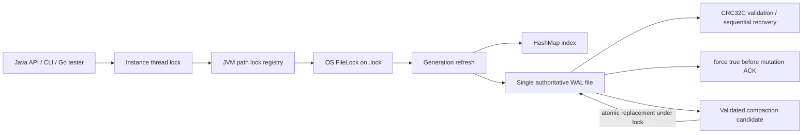

# TAROT architecture



## Persistent layout and record format

The authoritative database is one append-only file. A separate sibling file
named `<database>.lock` coordinates access; it contains no key/value data.
Version 1 records are encoded big-endian:

| Header field | Bytes | Meaning |
| --- | ---: | --- |
| Magic | 4 | `KVDB` |
| Version | 1 | Currently 1 |
| Type | 1 | PUT=1, DELETE=2, BEGIN=3, COMMIT=4 |
| Flags | 2 | Reserved; must be zero |
| Transaction ID | 8 | Positive signed 64-bit identifier |
| Payload length | 4 | Bytes following the header |
| CRC32C | 4 | CRC over header bytes 0–19 followed by payload |

PUT payloads contain key length, value length, key bytes, then value bytes.
DELETE payloads contain key length and key bytes. BEGIN stores the expected
operation count. COMMIT stores that count and a CRC32C over the complete encoded
batch operation records. Values are limited to 1 MiB, keys to 1–1024 bytes, and
batches to 10,000 operations.

The file format is unchanged by multi-process locking and incremental refresh.

## Writes and batches

PUT and DELETE append one checksummed record, call `FileChannel.force(true)`,
then update the in-memory index. BATCH appends BEGIN, all operation records, and
COMMIT; it forces the log before applying any batch operation to the index.
Recovery treats records in an uncommitted batch as invisible.

### Write path

The caller validates/copies arguments, takes the instance write lock, obtains
the JVM path lock and OS `FileLock`, refreshes the index to the current WAL
boundary, appends a record, forces the channel, and only then publishes the new
index entry and returns. Any uncertain append failure fails the current handle
so it cannot append behind a potentially torn suffix.

### Read path

GET takes the instance lock and the same exclusive path locks as a writer,
refreshes newly appended records, then reads the value bytes from the value
location in the authoritative WAL. Missing keys return not-found. This avoids
stale cross-process reads at the cost of serializing reads with writes.

### Batch transaction path

BATCH validates every operation before taking storage action. Under the global
locks it appends BEGIN with the expected count, all PUT/DELETE records, and
COMMIT with the count and transaction CRC. It forces once after COMMIT, then
applies all operations to the index while readers remain excluded. Recovery
validates the full transaction before publishing any member.

The configured maximum file size is checked before each WAL append. It is not a
compaction threshold; a database already larger than a newly supplied limit can
be opened and read, but additional writes may fail.

## Recovery and index refresh

At open, recovery scans from offset zero, validates record structure and
checksums, rebuilds the `HashMap` index, and truncates an incomplete or
uncommitted suffix to the last committed boundary. Truncation is forced before
the WAL writer opens.

The scanner uses a bounded 8 MiB sequential read cache to reduce system calls.
The cache contains raw WAL bytes, including values, but does not materialize
complete records or values in separate objects; record validation and CRC32C
coverage are unchanged.

Each open handle tracks the last verified record boundary and highest valid
transaction ID. Before every operation, while holding the global lock, it
replays only the suffix appended since that boundary. The index is updated
directly during replay because no other operation can observe it under the
exclusive path lock. If replay detects corruption or an I/O/runtime failure,
the instance is marked failed and requires close/reopen recovery.

## Thread and process coordination

Every operation follows this order:

1. Acquire that `DatabaseImpl` instance's read or write lock.
2. Acquire a JVM-wide `ReentrantLock` from a static registry keyed by the
   normalized absolute database path.
3. Open the sibling `.lock` file and acquire its exclusive `FileLock`.
4. Refresh from the WAL, perform the operation, and release the OS lock, JVM
   lock, then instance lock.

This handles same-JVM overlap separately from OS process coordination; Java
`FileLock` alone is not used as a thread lock. Interrupted acquisition restores
the thread's interrupt flag and reports an `IOException`. A process termination
releases its OS lock when its handles close. All operations, including reads,
are serialized globally, so this design does not provide parallel reads across
processes.

The lock registry retains entries for paths for the lifetime of the JVM.
Normalized paths that refer to the same file through aliases such as symlinks
may not map to the same coordination key; callers should use one stable path.

## Compaction protocol and replacement risk

`Database.compact()` and CLI `compact` / serve `COMPACT` are implemented. The
operation holds the normal exclusive path coordination lock for its full
duration. Data channels are opened per operation and closed before releasing
that lock, so cooperating processes do not retain the old data file during
replacement. A unique same-directory candidate contains standalone PUT records
for the live key/value set. TAROT forces it, fully recovers and validates it,
and compares every key and value against the source index before publishing.

The permitted `<database>.lock` file stores two generation slots. Compaction
forces a generation increment before `ATOMIC_MOVE` replacement. Every open
instance checks the generation while holding the OS lock and rebuilds its index
if it changed. If a process dies after the generation increment but before the
move, the old WAL remains authoritative and peers reload it. If a process dies
after the move, the compacted WAL is authoritative and peers reload it.
Candidate files are never recovery inputs; the next locked open removes only
files matching TAROT's reserved candidate name pattern. Filesystems without
atomic replacement make compaction fail; there is no non-atomic fallback.

Process-kill tests cover candidate writing, replacement, and the durable
generation-before-replacement state. They do not prove power-loss durability of
directory metadata or atomic rename on every filesystem. Replacing/deleting the
`.lock` file while any process is active is unsupported.

## Durability boundaries

Acknowledged writes call `FileChannel.force(true)`. The tests exercise simulated
truncated WALs, configured file-size limits, subprocess locking, and process
termination while holding the lock. They do not simulate power loss, physical
disk exhaustion, or hardware that fails to honor flush requests. Directory
metadata durability and file-lock semantics remain filesystem/platform
dependent.

## Failure and recovery evidence

| Scenario | Evidence | Result / boundary |
| --- | --- | --- |
| Partial standalone record or batch | `DatabaseCrashRecoveryTest`, `ConcurrencyAndWalValidationTest` | Invalid/incomplete suffix is excluded and truncated to the last committed boundary. |
| Batch commit | `DatabaseBatchTest`, `TenThousandBatchStressTest` | BEGIN/operations/COMMIT replay atomically; invalid input does not partially persist. |
| Concurrent API/process access | `ProcessLockTest`, `ConcurrencyAndWalValidationTest` | Same-JVM threads/instances and separate JVMs serialize on shared path locks. |
| Million-key recovery and compaction | `MillionKeyScaleTest`, Go `-mode scale` | Completed 1,000,000 inserts/deletes; compaction reduced the post-delete 114,012,000-byte WAL to 0 and post-compaction recovery preserved the empty state. |
| Compaction process termination | `CompactionTest`, Go `-mode compact -crash` | Tested candidate-write kill, generation-before-move recovery, post-replacement recovery, and active compaction kill. |
| Configured file limit | `DatabaseDiskFullTest`, `FileSizeLimitAfterCompactionTest`, Go `-mode limit` | Rejection preserves acknowledged records; compaction lets later writes fit. This is not physical disk exhaustion. |
| Compaction I/O failures | `CompactionFailureInjectionTest` | Injected create/write/validation/pre-replacement failures preserve original WAL and clean candidates; injected post-replacement failure recovers compacted state. |
| WAL short write / force / access denial | `StorageFailureInjectionTest` | Nine-byte partial tail is truncated; injected failed force and AccessDeniedException return no successful API result; the failed-force record is treated as uncertain. |
| WAL corruption | `WalCorruptionMatrixTest`, `ConcurrencyAndWalValidationTest` | Bad magic, length, CRC, type and batch metadata fail open without changing corrupt copies; incomplete trailing header/payload truncates safely. |
| Power loss / failed hardware flush | Not tested | `force(true)` is called before ACK; machine power loss and devices that ignore flushes are not simulated. |
| Directory metadata / all rename crash instants | Not tested | Atomic replacement tested on this Windows runtime, but filesystem-specific power-fail behavior is not established. |

## Build and test

```powershell
javac -Xlint:all -Werror -d out src/main/java/kvdb/*.java src/test/java/kvdb/*.java
```

Run test mains using `java -cp out kvdb.<TestClass>`. The 20 executed test mains
are listed in `README.md`; `ProcessLockWorker` and `CompactionWorker` are helper
programs invoked by their parent tests.

## CLI and Go integration

`kvdb.Main` provides one-shot `open`, `put`, `get`, `del`, `batch`, `dump`, and
`check` commands, plus a long-running `serve` mode. Keys and values are passed as
standard Base64 so arbitrary bytes can cross a line-oriented interface. The
serve protocol prints `READY`, accepts tab-separated PUT/GET/DEL/BATCH frames,
and returns `ACK <op-id>` for successful mutations only after the database API
has returned from its WAL force. The BATCH frame declares a count and is
followed by that many PUT/DEL subframes; the whole list is sent to one atomic
database batch call. Protocol errors use Base64-encoded messages.

`DUMP` returns a sorted snapshot as ENTRY rows. `COMPACT` runs the validated
replacement protocol above. `CHECK` performs a full recovery scan and can
truncate an incomplete tail, so it is a recovery/check operation, not a
non-mutating forensic validator.

The `torture/` Go module uses only the Go standard library. It runs one Java
serve process per writer, appends each successful ACK and its operation to a
separate synced JSONL oracle, and compares a post-restart DUMP with that oracle.
Seeded process kills retry the same idempotent request if its ACK was lost. The
configured file-size mode tests the Java maximum-size limit; it does not emulate
physical disk exhaustion. Current measurements and untested durability
boundaries are listed in `README.md` and `torture/README.md`.
